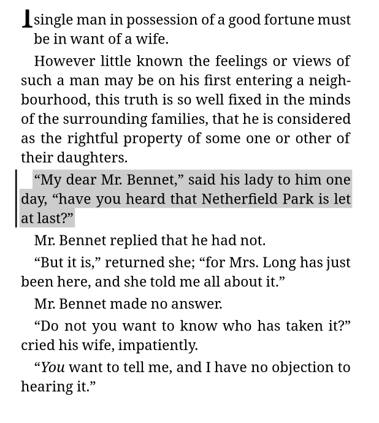
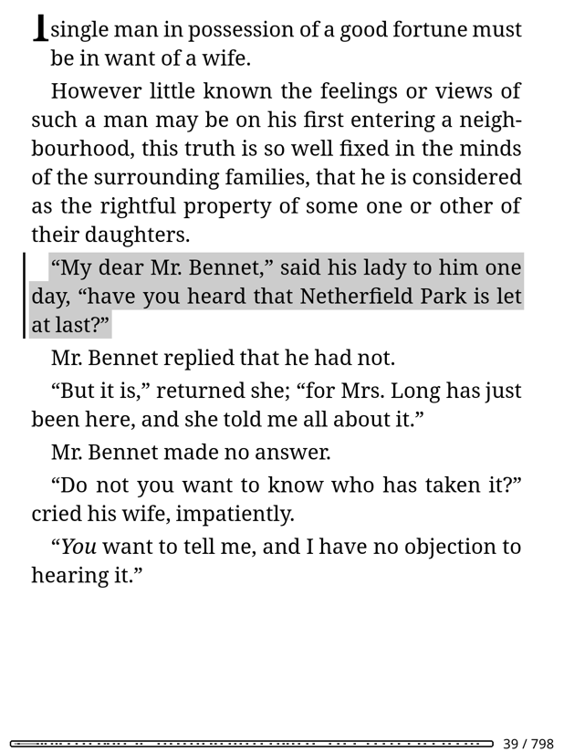
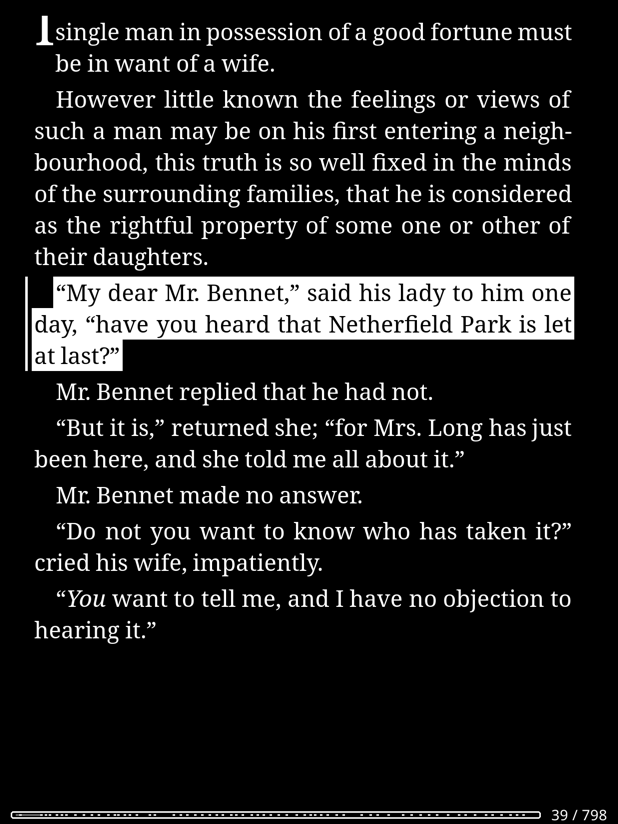
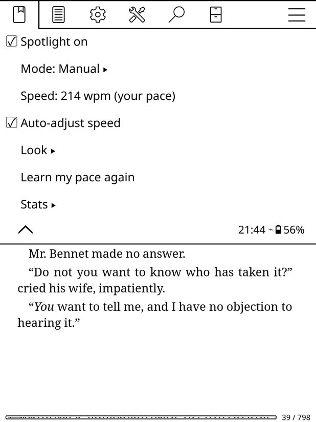
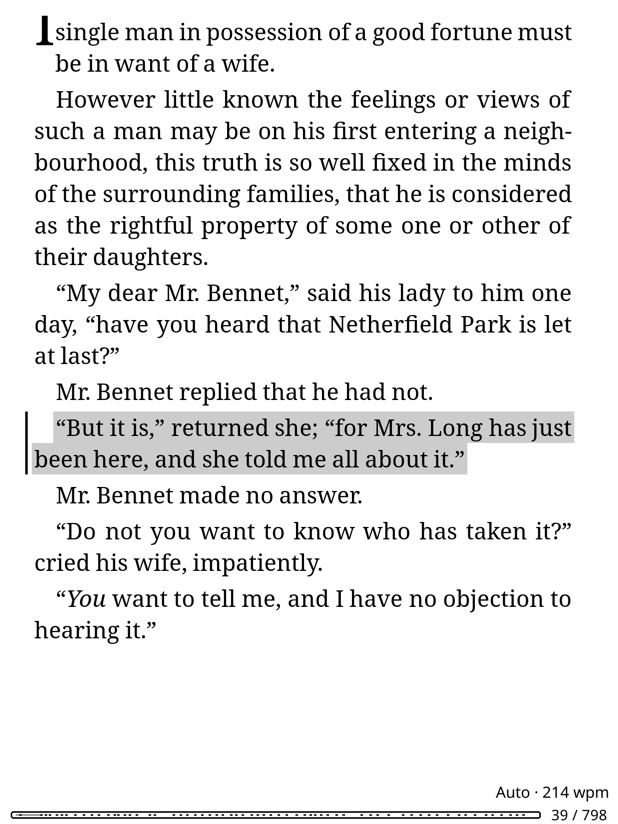
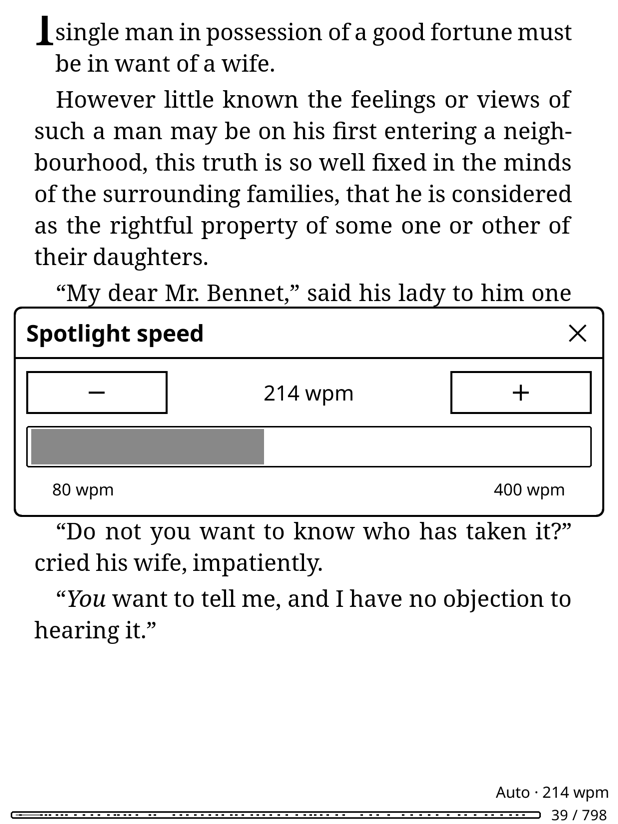
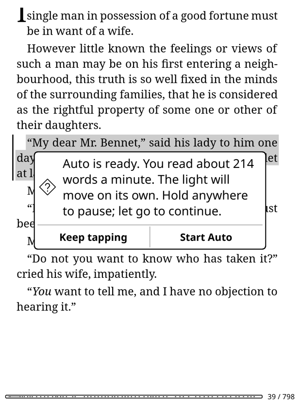
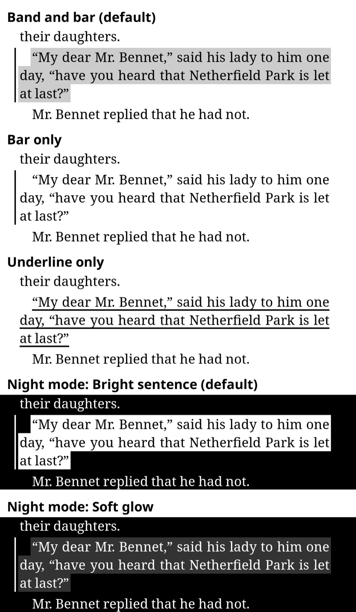
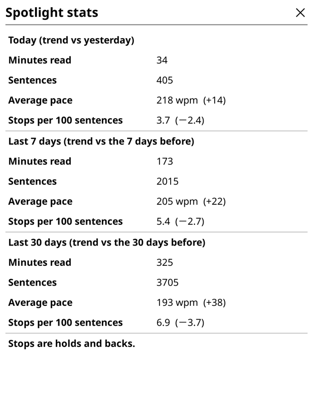

<p align="center">
  
</p>

<h1 align="center">Spotlight</h1>

<p align="center">
  <b>A sentence spotlight and an adaptive reading pacer for KOReader.</b><br>
  One sentence lit at a time. Tap to move the light, or let it move on its own at your pace.
</p>

<p align="center">
  
  
  
  
</p>

---

Long pages are hard to stay on. You reread a line, lose your place, look up,
and drift. **Spotlight** gives your eyes one place to be: the sentence you're
on gets a soft gray band and a bar in the margin, the *trail marker*. The
light moves one sentence at a time. Move it yourself with a tap, or switch on
**Auto** and let it carry you through the page at the pace Spotlight has
learned from your own reading. Hold anywhere to pause; let go to carry on.

<table>
  <tr>
    <td align="center"><br><sub>Day: a gray band and the trail marker</sub></td>
    <td align="center"><br><sub>Night: the sentence in day colours, a spotlight on the dark page</sub></td>
  </tr>
</table>

## Highlights

- 🔦 **One sentence at a time.** Text stays pure black, and the rest of the
  page is left alone: nothing is dimmed. Sentences carry over page breaks.
- 👆 **Manual mode.** Tap right for the next sentence, left for the previous
  one. Page keys work too.
- ⏱️ **Auto mode, the pacer.** The light moves on its own at *your* pace,
  learned from how you read in Manual mode. Hold anywhere to pause.
- 🎚️ **Auto-adjust.** Pausing a lot slows it down; skipping ahead speeds it up.
  Each book keeps its own pace.
- 🌙 **Made for e-ink.** It refreshes only the lines that change, with the
  fastest clean waveform, and leaves KOReader's "full refresh every N pages"
  as it is. Night mode gets its own look.
- 📊 **Reading stats.** Minutes, sentences, pace and stops for today, the last
  7 days and the last 30, with trends. Export them all as JSON.
- 🪶 **Light and safe.** Each page is read once and cached. When Spotlight is
  off, KOReader behaves exactly as normal.

## Contents

- [Install](#install)
- [Getting started](#getting-started)
- [Manual mode](#manual-mode)
- [Auto mode](#auto-mode)
- [Learning your pace](#learning-your-pace)
- [Auto-adjust](#auto-adjust)
- [Looks and night mode](#looks-and-night-mode)
- [Reading stats](#reading-stats)
- [Settings and gestures](#settings-and-gestures)
- [How it works](#how-it-works)
- [Troubleshooting](#troubleshooting)
- [Known limits](#known-limits)
- [Development](#development)
- [Credits](#credits)

## Install

You need a Kindle (or any e-reader) running [KOReader](https://koreader.rocks).

1. Download this repository (Code → Download ZIP) and unzip it.
2. Connect the Kindle by USB and copy the **`spotlight.koplugin`** folder into
   **`koreader/plugins/`**, so you end up with
   `koreader/plugins/spotlight.koplugin/main.lua`.
3. Eject the Kindle and restart KOReader: top menu → ☰ → Exit, then start it
   again (from KUAL on a Kindle). Plugins are only loaded at start.

To update, replace the whole `spotlight.koplugin` folder and restart KOReader
again. Your settings, learned pace and stats are kept.

<details>
<summary><b>Try it on a Mac first</b></summary>

KOReader's stable releases have no macOS app; it is only in the nightly
builds. On [github.com/koreader/koreader/releases](https://github.com/koreader/koreader/releases),
open the release tagged **ota** and download `koreader-macos-11.0-arm64-….7z`
(Apple Silicon) or `koreader-macos-10.15-x86_64-….7z` (Intel).

1. Start KOReader once and quit it. That creates its settings folder.
2. Copy `spotlight.koplugin` into `~/Library/Application Support/koreader/plugins/`.
   If it doesn't show up, put it inside the app instead: right-click
   KOReader.app → Show Package Contents → `Contents/koreader/plugins/`.
3. Start KOReader and open an EPUB.

</details>

## Getting started

Open a book and tap the top of the screen to bring up KOReader's menu.
**Spotlight** is the first entry of the first tab. Choose **Spotlight on**.
The setting is remembered for all books.

<p align="center">
  
</p>

For a book Spotlight can't handle (PDF, comics), the entry reads "Spotlight
(not for this book)". If something goes wrong when the plugin starts, it
reads "Spotlight (could not start)"; tap it to see why.

## Manual mode

You move the light.

| Do this | Spotlight does |
|---|---|
| Tap the right three quarters of the screen | Next sentence |
| Tap the left quarter | Previous sentence |
| Forward or back page key | Next or previous sentence |
| Tap a link | Follows the link, as usual |
| Hold | KOReader's usual dictionary and highlighting |
| Swipe, or turn the page any other way | Lights the first sentence on the new page |

- **KOReader's own taps still work.** The top strip opens the menu. The
  bottom strip opens the settings bar and the footer. The screen corners and
  the taller areas in the middle of the top and bottom edges do what they
  always do.
- **Sentences across a page break.** The part you can see is lit first. The
  next tap turns the page and lights the rest. Going back works the same way.
- **Per book.** Spotlight remembers the sentence you were on and lights it
  again when you open the book.
- **Quietly learning.** Every sentence is timed in the background, to learn
  your pace for Auto mode.

## Auto mode

The light moves on its own. Spotlight → **Mode** → **Auto**.

| Do this | Spotlight does |
|---|---|
| Touch and hold anywhere | Pauses while your finger is down |
| Let go | Carries on: the time that was left on the sentence, plus 0.5 s |
| Quick tap right (or forward key) | Skips ahead one sentence now |
| Quick tap left (or back key) | Goes back one sentence and carries on from there |
| Swipe or other page turn | Carries on from the first sentence on the new page |
| Open a menu | The light waits until it closes |

<table>
  <tr>
    <td align="center"><br><sub>The <b>Auto · 214 wpm</b> indicator, bottom right</sub></td>
    <td align="center"><br><sub>The speed panel: − / + and a slider, 80–400 wpm</sub></td>
  </tr>
</table>

- **Holding never opens the dictionary in Auto mode.** The pause starts the
  moment your finger lands, not when KOReader recognizes a hold half a second
  later. If the light moved on in the instant before your finger landed, it
  goes back to the sentence you were aiming at.
- **Page turns get a moment.** The first sentence on a new page gets an extra
  0.8 s. A sentence split by a page break gets its share of the time on each
  page.
- **It waits for you.** When you open a book in Auto mode, or the Kindle
  wakes up, the light waits for your first tap so you can find your place.
  At the end of the book it stops.
- **The indicator** shows "Auto" and the speed. If KOReader's footer is set
  to show all its items at once, the indicator is one of them; otherwise it
  is a small label in the corner.
- **Speed panel:** Spotlight → **Speed**. − and + change the speed by 5 words
  a minute; tap or drag the bar to set it. It changes at once, even for the
  lit sentence, and the new speed is kept for this book.
- **The Kindle stays awake while the light moves.** KOReader's auto-suspend and
  the Kindle's own sleep timer are held off only while the light is moving,
  the way KOReader's Auto-turn plugin does it.

## Learning your pace

The first time you choose Auto, Spotlight learns how you read before it
moves the light for you. It stays in Manual mode while you tap through as
usual. Spotlight → Mode shows how far it has got, e.g. "Auto (learning your
pace: 23 of 40 sentences)".

<p align="center">
  
</p>

After at least **40 sentences** and **3 minutes** of reading, about 2–3
pages, Auto is ready. **Start Auto** switches to Auto at your pace. **Keep
tapping** stays in Manual mode; the next time you choose Auto, it starts at
once.

<details>
<summary><b>Which sentences count, and the pace model</b></summary>

A sentence's timing counts only if:
- it wasn't reread;
- it wasn't the first sentence after a page turn, or split by one;
- it took between 120 and 1,500 ms per word, and under a minute in all.

**The pace model:** each sentence stays lit for *a fixed pause + its words ×
your time per word*. Both numbers are fitted by least squares to your 150
most recent valid timings. The pause is kept between 0.2 and 1.5 s. If the
fit can't be trusted, Spotlight uses your median words a minute with a 0.4 s
pause instead: that happens with too few timings, sentences that are all
about the same length, or an implausible result. The speed shown everywhere
(popup, indicator, panel) is the per-word part; the short pause per sentence
comes on top.

**It keeps learning.** Every valid Manual timing refines your pace, even if
you never use Auto, so it stays current.

**Each book keeps its own pace** once you change it there: speed panel,
Faster/Slower, or auto-adjust. Other books start from your learned pace.
Spotlight → Speed shows which applies: "(this book)", "(your pace)" or
"(not learned yet)".

**Learn my pace again** forgets your timings and learned pace, and resets the
current book's own speed. Other books keep theirs. Learning then starts over.

</details>

## Auto-adjust

Spotlight → **Auto-adjust speed** (on by default). Spotlight watches your Auto
reading in windows of 15 sentences:

| In the last 15 sentences | Speed |
|---|---|
| 3 or more stops (holds or backs) | 5 % slower |
| No stops, at least one skip-ahead | 5 % faster |
| No stops and no skips, two windows in a row | 2 % faster |

It makes at most one change per window and stays within 80–400 words a
minute. Changes show only in the indicator, never as a popup while you
read, and are kept for the book. When you turn Auto off or close the book, a
short note shows how the session went: *"Started at 172, ended at 181 words
a minute."*

## Looks and night mode

Spotlight → **Look**:

- **Style:** band and bar (default), bar only, or underline only.
- **Band darkness:** light, medium (default, the same gray as KOReader's
  highlights) or dark.
- **Bar width:** 4, 5 (default) or 6 pixels. The bar sits just left of where
  the page's lines start, at the same place for every sentence on the page.
- **In night mode:** *Bright sentence* (default) shows the lit sentence in
  day colours, black on white on the dark page. *Soft glow* keeps a dim
  band. Spotlight follows KOReader's night mode by itself.

<p align="center">
  
</p>

## Reading stats

Spotlight → **Stats** → **Show stats**: today, the last 7 days and the last 30
days on one screen.

<p align="center">
  
  <br><sub>Shown with sample data</sub>
</p>

- **Minutes read.** Only time spent reading counts: a gap of more than 90
  seconds (you put the Kindle down) is left out.
- **Sentences** read.
- **Average pace**, in words a minute of reading time.
- **Stops per 100 sentences**, counting holds and backs.
- **Trends** compare each period with the one before: yesterday, the 7 days
  before, the 30 days before.

A session is one stretch of reading in one book, from opening it to closing
it, or until the Kindle has slept for more than 30 minutes. Sessions are
saved in `koreader/settings/spotlight_stats.json`, including when the Kindle
goes to sleep.

**Export:** Spotlight → Stats → **Export stats (JSON)** copies every session to
`spotlight/spotlight_stats.json` in KOReader's home folder. On a Kindle, that's
a `spotlight` folder at the top of the USB storage.

<details>
<summary><b>The JSON format</b></summary>

Plain, descriptive field names, with a `fields` section that describes each
one, so the file can be imported elsewhere as is. Times are local time.

```json
{
  "format": "spotlight-sessions",
  "version": 1,
  "fields": { "active_seconds": "reading time; gaps over 90 seconds are left out", "...": "..." },
  "sessions": [
    {
      "id": "20261025-213322-cb511a",
      "date": "2026-10-25",
      "started_at": "2026-10-25T21:23:37",
      "ended_at": "2026-10-25T21:33:23",
      "book_title": "Pride and Prejudice",
      "active_seconds": 586,
      "manual_seconds": 397,
      "auto_seconds": 189,
      "sentences": 74,
      "words": 1827,
      "average_wpm": 187,
      "holds": 4,
      "backs": 2,
      "skip_aheads": 1,
      "starting_pace_wpm": 200,
      "ending_pace_wpm": 228,
      "auto_adjust_changes": 1
    }
  ]
}
```

</details>

## Settings and gestures

| Spotlight menu | What it does |
|---|---|
| Spotlight on | Turns Spotlight on or off, for all books |
| Mode | Manual or Auto (shows learning progress until Auto is ready) |
| Speed | Opens the speed panel; shows whose pace applies |
| Auto-adjust speed | Lets Auto nudge the speed from your holds, backs and skips |
| Look | Style, band darkness, bar width, night look |
| Learn my pace again | Starts learning your pace from scratch |
| Stats | Show stats, export stats (JSON) |

**Gesture actions.** Bind any of these to a gesture: top menu → ⚙ → Taps and
gestures → Gesture manager → pick a gesture → Reader.

- Toggle Spotlight
- Spotlight: next sentence / previous sentence
- Spotlight: toggle Auto (also turns Spotlight on)
- Spotlight: faster (+5 wpm) / slower (−5 wpm)
- Spotlight: speed panel
- Spotlight: show stats

## How it works

<details>
<summary><b>Finding sentences</b></summary>

crengine (KOReader's EPUB engine) has no sentence or paragraph API. Spotlight
steps through the page word by word and reads the text between words.
crengine marks every block boundary (paragraph, heading, list item, line
break) with a newline, so block ends are exact. The rules live in
[`sentences.lua`](spotlight.koplugin/sentences.lua):

- A sentence ends at `.` `!` `?` or `…`, plus any closing quotes or brackets,
  followed by whitespace.
- It doesn't end after common abbreviations (Mr, Mrs, Ms, Dr, Prof, St, vs,
  etc, e.g, i.e, fig, no, vol, approx, the month abbreviations, U.S, U.K, a.m,
  p.m) or after a single capital initial (J. R. R. Tolkien).
- It doesn't end when the next letter is lower case ("Wait… what?"), or
  inside a number (3.5).
- The end of a block always ends a sentence, so headings and list items are
  their own units.
- One-word fragments ("Nothing.") join the sentence before them. If the
  fragment starts its paragraph, it joins the sentence after it.

Spotlight reads back from the top of the page to the start of the
paragraph, and past the bottom until the last sentence closes. So a sentence
split by a page break is known as a whole on both pages.

</details>

<details>
<summary><b>E-ink refresh and cost</b></summary>

- Only the area of the old and new sentence is refreshed. Spotlight uses
  "ui", the fastest waveform that shows gray cleanly, or "fast" for the
  bar-only and underline styles, where only black pixels change. Neither
  counts toward KOReader's "full refresh every N pages". Page turns use
  KOReader's own refresh, so that setting keeps working.
- Sentences are worked out for the current page and the next one, and cached
  per page. They're worked out again only when the layout changes (font,
  size, margins, spacing, rotation). Reading a page takes a few milliseconds
  on a desktop. Spotlight logs the time for each page, so you can check it on
  your device.
- Reading text from crengine makes it redraw the page on the next paint. So
  Spotlight only reads text right before a page is drawn anyway, never while
  stepping between sentences.

</details>

<details>
<summary><b>Input, and leaving KOReader alone</b></summary>

- **Taps:** one full-screen tap zone, declared to take priority over
  KOReader's page-turn taps and its tap-on-highlight handler. It declines
  (KOReader then handles the tap) when Spotlight is off, during a text
  selection, and in KOReader's menu and settings areas. KOReader's link zone
  already outranks those, so links still win.
- **Holds in Auto mode:** a zone with priority over KOReader's highlight and
  footer holds, active in Auto mode only. KOReader passes every gesture to its
  modules before its touch zones run. Spotlight uses that to watch for finger
  down ("touch", sent at once) and the end of a contact, without taking
  either.
- **Page keys:** KOReader's page-turning module handles them before any
  plugin sees them. While Spotlight is on, it marks that module's two
  page-key entries inactive (a flag KOReader's own key handling checks) and
  handles the same keys itself. No KOReader code is replaced.
- **The pacer** uses one timer, cancelled whenever the light pauses: finger
  down, sleep, the end of the book, Manual mode, Spotlight off, closing the
  book.

</details>

## Troubleshooting

Each time a book opens, Spotlight writes a line with its version to the log,
for example `Spotlight 0.5.0 (M5) : ready, turned off`.

- **Kindle:** `koreader/crash.log` on the USB storage.
- **Mac:** `crash.log` in `~/Library/Application Support/koreader/`.

If that line is missing, KOReader didn't load the plugin. Check that the
folder is `koreader/plugins/spotlight.koplugin` (not one level deeper), and
restart KOReader. If the plugin runs into an error, KOReader keeps running:
plugin event handlers run in a protected call, and the error goes to the
same log. Spotlight also writes one line per page it reads (`Spotlight:
page 12, 9 sentences from 412 words in 38 ms`); the time is what it adds to
a page turn.

## Known limits

- Page mode only. In scroll mode Spotlight stays off and says so.
- Reflowable books only: no PDF, DjVu or CBZ.
- Two-page (landscape) mode hasn't been checked on a device yet.
- "etc." and the other abbreviations never end a sentence, even when one
  really ends there.
- While Spotlight is on, tapping a saved highlight moves the light instead of
  opening the highlight's menu. Turn Spotlight off to open it.
- Right-to-left books: the back zone is always on the left.
- In illustrated editions, a picture in the middle of a paragraph splits the
  sentence around it, and captions are lit as sentences.
- Sentences longer than about 200 words that run over a page break may be
  split where the page breaks.
- If the footer is hidden and a book has a very small bottom margin, the Auto
  label can sit close to the last line.
- Stats count reading with Spotlight on only. KOReader's own Reading
  statistics plugin covers everything else.

## Development

```
spotlight/
├── spotlight.koplugin/     the plugin: the only folder that goes on the e-reader
│   ├── main.lua            KOReader side: reading pages, drawing, input, menus, events
│   ├── sentences.lua       sentence boundaries        (no KOReader dependencies)
│   ├── pace.lua            every tunable number, timings, pacer, pace model, auto-adjust
│   │                                                  (no KOReader dependencies)
│   ├── stats.lua           session records and summaries (no KOReader dependencies)
│   ├── speedpanel.lua      the speed panel
│   └── _meta.lua
├── tests/                  desktop tests (plain LuaJIT) and the KOReader harness
└── docs/images/            README images, rendered by tests/koreader/screenshots.sh
```

All the tunable numbers (timings, thresholds, auto-adjust steps) are in one
table, `Pace.config`, at the top of [`pace.lua`](spotlight.koplugin/pace.lua).

**Desktop tests.** `sentences.lua`, `pace.lua` and `stats.lua` are plain Lua.
`main.lua` is tested against a fake crengine document that copies crengine's
word-walking rules (from `crengine/src/lvtinydom.cpp`), with a clock the
tests move by hand.

```bash
luajit tests/run.lua
```

**End-to-end in real KOReader.** `tests/koreader/` runs Spotlight inside the
real KOReader, headless, on a real EPUB:
- the screen is sized like a Kindle Paperwhite (1236 × 1648, 300 dpi);
- it sends real tap, hold, swipe and key events;
- it prints PASS or FAIL per check, and saves screenshots.

It needs the KOReader macOS app from the nightly builds, and any EPUB.
Nothing is installed: each run uses a throwaway settings folder.

```bash
tests/koreader/run.sh path/to/KOReader.app path/to/book.epub 20
```

**README images.** Rendered the same way, on *Pride and Prejudice*:

```bash
tests/koreader/screenshots.sh path/to/KOReader.app path/to/pride-and-prejudice.epub
```

## Credits

- [KOReader](https://github.com/koreader/koreader) and its crengine engine.
  The Perception Expander plugin and the community
  [Reading Ruler](https://github.com/Syakhisk/readingruler.koplugin) plugin
  showed the way for drawing over the page.
- Screenshots show *Pride and Prejudice* by Jane Austen, illustrated by Hugh
  Thomson (George Allen, 1894), from
  [Project Gutenberg](https://www.gutenberg.org/ebooks/1342).
